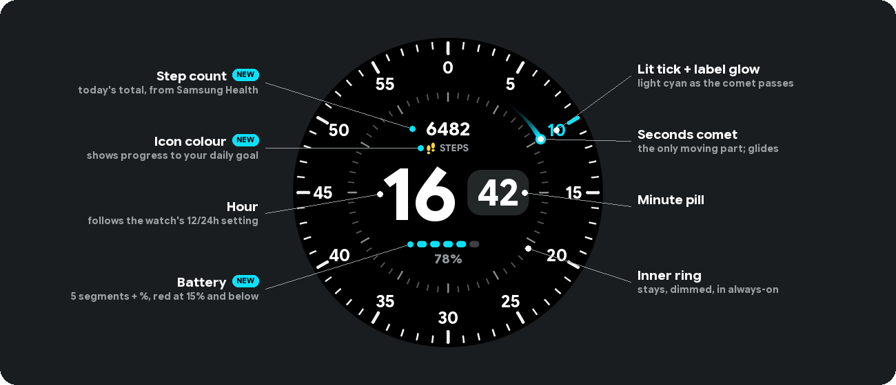
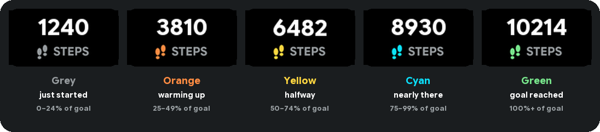
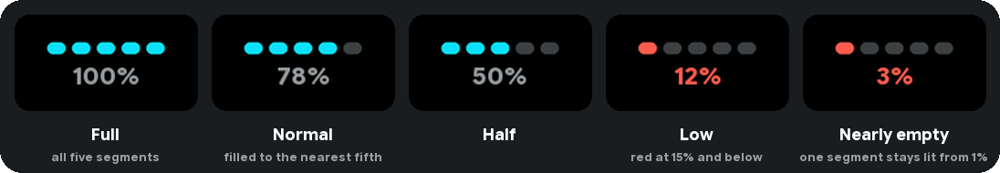
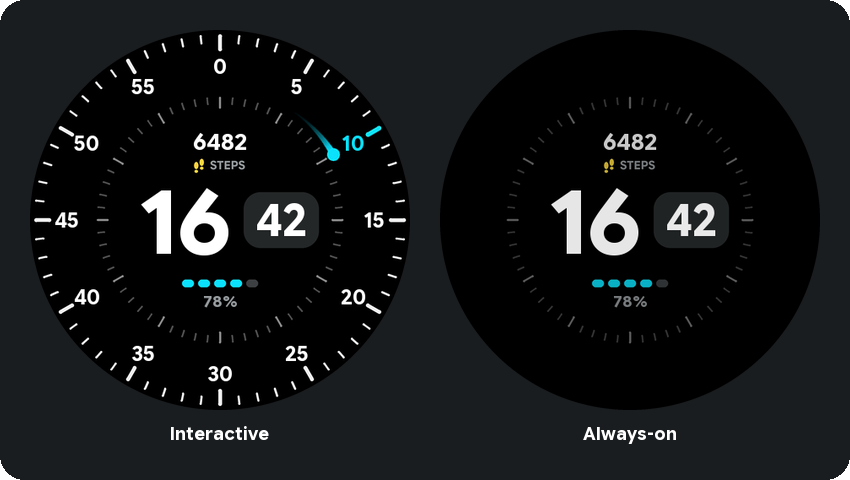
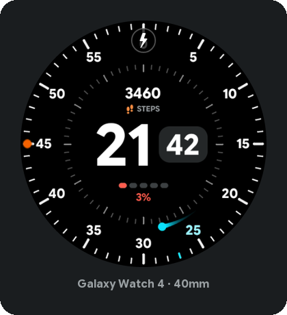

# Radial Clock — Galaxy Watch 4 watch face

A native Wear OS watch face built with
[Watch Face Format](https://developer.android.com/training/wearables/wff) (WFF).



## What's new

### Step counter

Today's step count sits above the time, read from Samsung Health. The small footprints
icon beside **STEPS** changes colour as you get closer to your daily goal. The stages are
shares of whatever goal you set in Samsung Health, so if you change your goal, the stages
change with it:



### Battery

Five segments under the time, filled to the nearest fifth, with the exact percentage
underneath. It turns red at 15% and below, and one segment stays lit down to 1% so a nearly
flat battery never looks empty:



Both read the watch's own data (`[STEP_COUNT]`, `[STEP_PERCENT]`, `[BATTERY_PERCENT]`) rather
than complication slots, so there is nothing for Samsung's runtime to reject. Both were
enlarged after testing on the wrist: at the 40mm watch's scale, small text was hard to read.

### Always-on

The comet and outer ring switch off. The inner ring, time, steps and battery stay, dimmed:



### On the watch

A real screenshot from a Galaxy Watch 4 (40mm), at 3% battery while charging. The bolt at
the top and the orange dot at 9 o'clock are the system's own charging and notification
indicators, not part of the face.



## Why it isn't just the HTML

Wear OS watch faces have no WebView — there is no API that renders HTML/CSS/JS as a watch
face. WFF is a declarative XML format the system renders itself, which is what makes
always-on display and the power budget possible. So the design is rebuilt, not embedded.

The current design follows
[`design/mockups/radial-clock-comet-concept.png`](design/mockups/radial-clock-comet-concept.png):

| Element | How it is built |
|---|---|
| Outer ring: 60 white ticks, labels 0–55 | one static PNG for the ticks, 12 static `PartText` labels |
| Inner ring: 60 grey ticks | one static PNG |
| Hour + minute pill | two `PartText`s and a small filled pill PNG; the hour is right-aligned against the pill |
| Steps above the time: count, then a footprints icon beside "STEPS" | a `PartText` on `[STEP_COUNT]`, a static label PNG, and five icon PNGs stacked in one spot, one visible at a time: grey, orange, yellow, cyan, green at 0/25/50/75/100% of `[STEP_PERCENT]` (the wearer's Samsung Health goal) |
| Battery: five segments + percentage under the time | three tiny segment PNGs (track, cyan, red) placed five times, lit by arithmetic alpha on the built-in `[BATTERY_PERCENT]`; red at 15% and below. No `ComplicationSlot`. Dimmed, not hidden, in ambient |
| Seconds comet (dot, stem, fading tail) | the only moving part: one small cropped PNG inside a full-canvas `Group` rotated by `6 * [SECOND_MILLISECOND]` |

The earlier design rotated a whole tick dial and counter-rotated 12 live labels every
frame, which looked laggy. Now nothing but the comet moves.

## Layout

```text
settings.gradle.kts, build.gradle.kts, gradle.properties, gradlew(.bat)
tools/generate.py                <- source of truth for geometry; regenerates assets + XML
tools/readme_images.py           <- renders the README graphics into docs/images/
docs/images/                     <- GENERATED — README graphics
watchface/
  build.gradle.kts
  GOOGLE-SANS-FLEX-OFL.txt       <- font license (SIL OFL 1.1)
  src/main/
    AndroidManifest.xml          <- hasCode=false, WFF format version 1 (see Notes)
    res/raw/watchface.xml        <- GENERATED — edit generate.py, not this
    res/drawable/                <- GENERATED — ticks, pill, comet, lit ticks, battery
                                    segments, step icons + label, preview
    res/font/                    <- Google Sans Flex, static Bold instance
    res/xml/watch_face_info.xml
    res/values/strings.xml
```

`res/raw/watchface.xml` and everything in `res/drawable/` are generated. To change the
design, edit the constants at the top of `tools/generate.py` and re-run it:

```powershell
python tools/generate.py
```

It needs Python 3 with `pillow` (`python -m pip install pillow`).

After a design change, refresh the README graphics too. Pass a screenshot from the watch to
also update `on-watch.png`; without one, that image is left as it is:

```powershell
python tools/readme_images.py [watch-screenshot.png]
```

## Build

Nothing extra needs installing — this machine already has Android Studio (with its bundled
OpenJDK 21), the Android SDK, `adb`, build-tools 34.0.0/36.1.0, platforms android-35 and
android-36.1, and a cached Gradle 9.0.0. None of it is on `PATH`, hence the absolute paths
below.

Easiest route is **Android Studio**: `File > Open` → this project folder → let it sync →
`Build > Build Bundle(s)/APK(s) > Build APK(s)`.

From the command line, use the checked-in Gradle wrapper:

```powershell
.\gradlew.bat --no-daemon :watchface:assembleDebug
```

If Gradle can't find a JDK, point it at Android Studio's bundled one first:
`$env:JAVA_HOME = "C:\Program Files\Android\Android Studio\jbr"`.

Two things worth knowing if you touch the build config:

- **AGP is pinned to 8.13.2** because the installed Gradle is 9.0.0. AGP 8.7 and earlier fail
  against Gradle 9.
- **`local.properties` must not have a BOM.** PowerShell 5.1's `Out-File -Encoding utf8`
  writes one, and Java's properties parser then can't read `sdk.dir`, producing a misleading
  "SDK location not found". Write it with `-Encoding ascii`, or let Android Studio create it.

The debug APK lands in `watchface/build/outputs/apk/debug/watchface-debug.apk` (~115 KB).
It's debug-signed, which is all a sideload needs.

### Release builds

Signing material lives **outside the repository**, in `~/.radial-clock-signing/`, so that
nothing in the project tree can leak it into a commit and no editor watching the workspace
ever sees the passwords. Override the location with the `RADIAL_CLOCK_SIGNING` env var.
Without that directory the release build still succeeds — it just comes out unsigned — so a
fresh clone is not blocked.

To set it up:

```powershell
mkdir "$env:USERPROFILE\.radial-clock-signing"; cd "$env:USERPROFILE\.radial-clock-signing"
& "C:\Program Files\Android\Android Studio\jbr\bin\keytool.exe" -genkeypair -v `
    -keystore radial-clock.jks -alias radialclock -keyalg RSA -keysize 4096 -validity 10000
```

Then `keystore.properties` beside it, written with `-Encoding ascii` — PowerShell 5.1's
default `utf8` adds a BOM that Java's properties parser cannot read, which surfaces as a
misleading "SDK location not found":

```
storeFile=radial-clock.jks
storePassword=...
keyAlias=radialclock
keyPassword=...
```

**Back the `.jks` up somewhere safe.** Losing it is worse than leaking it: without it you
cannot ship an update that installs over an existing copy, and every user would have to
uninstall and re-add the face.

Then `gradle :watchface:assembleRelease`. Verify what you actually built before shipping it:

```powershell
& "$env:LOCALAPPDATA\Android\Sdk\build-tools\36.1.0\apksigner.bat" verify --print-certs `
    watchface\build\outputs\apk\release\watchface-release.apk
```

It must **not** say `CN=Android Debug`. A release APK cannot install over a debug one —
signatures differ, and you get `INSTALL_FAILED_UPDATE_INCOMPATIBLE` — so uninstall first.

## Install on the Galaxy Watch 4

**Enable developer mode on the watch** (already done on this watch)

1. Settings → About watch → Software info → tap **Software version** seven times.
2. Settings → Developer options → turn on **ADB debugging** and **Wireless debugging**.

**Connect**

Wear OS 6 uses paired wireless debugging:

```powershell
# Developer options > Wireless debugging > Pair new device  (gives an IP:port and a 6-digit code)
adb pair 192.168.1.x:xxxxx

# Developer options > Wireless debugging  (shows a different IP:port for the connection)
adb connect 192.168.1.x:xxxxx
adb devices
```

Keep the watch and PC on the same Wi-Fi, and keep the Wireless debugging screen open while
pairing. Accept the "Allow debugging?" prompt on the watch.

**Install**

```powershell
& "$env:LOCALAPPDATA\Android\Sdk\platform-tools\adb.exe" install -r `
    watchface\build\outputs\apk\debug\watchface-debug.apk
```

Or straight from Gradle: `gradle :watchface:installDebug`.

**Select it**, either on the watch — long-press the current face → swipe to the end →
**Add watch face** → **Radial Clock** — or over adb:

```powershell
& "$env:LOCALAPPDATA\Android\Sdk\platform-tools\adb.exe" shell am broadcast `
    -a com.google.android.wearable.app.DEBUG_SURFACE `
    --es operation set-watchface `
    --es watchFaceId com.gilmorecollins.radialclock
```

A successful call replies `result=1, data="Favorite Id=[n] Runtime=[2]"`. Pass **only**
`watchFaceId` — a declarative face has no class name of its own, so adding `--ecn component`
gets you either "Both component name and watchface id are specified" or "Class name cannot
be a placeholder".

## Notes

- **The seconds comet glides, and there is a trick keeping it fluid.** By default the runtime
  presents a watch face at a flat **10.0 fps** — a dead-regular 100 ms cadence on a 60 Hz
  panel, even though a frame costs only 15–34 ms to draw. That throttle is what makes a
  continuously rotating dial look choppy, and it is not something you can optimise away:
  deleting all 24 dial labels made each frame 38% cheaper and left the rate at 10 fps.

  `<Sweep>` is the only explicit frame-rate request in the format, and it is defined for
  `AnalogClock` hands rather than `Group`s. So the face carries an **invisible swept second
  hand** (`alpha="0"`) that draws nothing and exists purely as a hint — and the rate it
  unlocks applies to the whole surface, so the comet rides along.

  Measured with `dumpsys SurfaceFlinger --latency` on the wallpaper layer, screen on, with
  the **earlier rotating-dial design**. The face now uses `frequency="SYNC_TO_DEVICE"`,
  which has not been measured on the watch yet:

  | build | fps | p50 gap | janky |
  |---|---|---|---|
  | no hint | 10.0 | 100 ms (flat) | 0% |
  | `Sweep frequency="15"` | 20.2 | 50 ms | 0% |
  | `Sweep frequency="60"` | **24.6** | 33 ms | 0% |

  At `60` many frames land on a single vsync and the median frame time drops to 15 ms,
  because the CPU stays clocked up instead of idling between frames. Note the rate is *not*
  capped at the `frequency` value — 15 yielded 20 fps.

  Toggles in `tools/generate.py`: `FRAME_RATE_HINT = False` restores the stock 10 fps;
  `SECONDS_SOURCE = "SECOND"` replaces the glide with a 1 Hz step, which is cheapest of all
  but loses the radial motion the design is built around. **Neither is worth doing for
  battery** — see below.

- **Battery: the glide is not the problem.** Measured over 5h 40m of ordinary wear with AOD
  on, 95% → 57% (91.7 mAh of a 240 mAh cell):

  | | mAh | share |
  |---|---|---|
  | watch face runtime (`com.samsung.wear.watchface.runtime`) | 2.56 | 2.8% |
  | `ambient_display` (the AOD panel) | 25.8 | 28% |
  | system (UID 1000) | 8.61 | 9.4% |

  `Screen on discharge: 0 mAh. Screen doze discharge: 91.7 mAh.` The screen was on for
  13m 13s of 5h 40m (3.9%) across 161 wrist raises — ~5s per glance — and *interactive*
  time, when the 24.6fps glide actually runs, was 3m 11s (0.9%). Total discharged while
  the screen was on: 1%, against 38% overall.

  So the frame-rate hint costs on the order of 1% of battery over a working day's wear.
  The dominant cost is the AOD panel being lit at all, and at 2.04% mean luminance our
  emission is a small part of that — dimming the face would recover very little. Projected
  life is ~15h from full with AOD on; the real lever is AOD itself, not this watch face.

  Read it again with: `adb shell dumpsys batterystats`, then find the UID of
  `com.samsung.wear.watchface.runtime` via `adb shell pm list packages -U` (it renders the
  face; the `radialclock` package itself is inert and will look idle).
- **Always-on display.** Ambient keeps the grey inner ring at alpha 160, the hour and
  minute pill at 230, and the steps and battery at 200. The comet goes dark because ambient refreshes once a minute, so it
  would sit frozen on a stale second; the outer ring goes with it, since without the comet
  it carries no information.

  The quality bar (WO-P7) is 15% **mean luminance** across the face, not a count of lit
  pixels. With the earlier design the full interactive face measured 4.46% and ambient
  **2.63%**; the current ambient face shows less, so it is lower still. There is no power
  argument for hiding anything else — tune `AMBIENT_DIAL_ALPHA` / `AMBIENT_TEXT_ALPHA` in
  `generate.py` freely.

  Verified on-device: with the watch worn, `mScreenState=DOZE` and the face measures
  **2.04%** mean luminance. The screen only enters AOD when worn — there is no adb command
  to force it, so this cannot be checked with the watch sitting on a desk.

- **Burn-in protection is ours to do; the system does not do it.** Two AOD frames 75s apart
  put the hour glyphs on *pixel-identical* coordinates (0.00px drift), and the frames
  genuinely differed elsewhere — 5,899 pixels changed across the minute dial — so the
  capture was live, not a stale buffer. Neither the WFF ambient docs nor the quality
  guidelines mention pixel shifting at all.

  So `burn_in_drift` wraps the whole face and nudges it around a 5×5 one-pixel lattice, one
  step per minute:

  ```xml
  <Transform target="x" value="[MINUTE] % 5 - 2" />
  <Transform target="y" value="floor([MINUTE] / 5) % 5 - 2" />
  ```

  Integer modular arithmetic rather than `sin`/`cos` on purpose: the docs never say whether
  WFF's trig takes degrees or radians, and this needs no such assumption. Measured after the
  change, consecutive minutes move the hour by 0.75px on the 396px screen — one design unit
  — while y correctly holds still until the 5-minute step. Set `BURN_IN_DRIFT = False` to
  disable.
- **Hour format** follows the watch's own 12/24-hour setting via
  `[IS_24_HOUR_MODE] ? [HOUR_0_23] : [HOUR_1_12]`. The web version was hardcoded to 24-hour.
- **Format version must stay at 1** on this watch. Declaring `5` builds and installs fine,
  but Samsung's runtime silently never registers the package as a declarative watch face, so
  it never reaches the picker — no error anywhere, it simply isn't listed. The tell is in
  logcat: a working face logs
  `WCSExt: [PackageEventHandler] dwf watchface Info [<package>]` on install, and with
  version 5 that line is absent. Every declarative face preinstalled on the device
  (`com.samsung.sree.*`) declares version 1. This is why the labels use plain
  `<Text align="CENTER">` and not `verticalAlign`, which is a v5 feature — text centres
  vertically in its box by default anyway, so nothing was lost.
- **Keep `watch_face_info.xml` minimal.** `<Preview>` is the only required element, and an
  unrecognised value in an optional one is another way to get silently dropped from the
  picker.
- **Screen sizes.** The face is designed on the standard 450×450 canvas and WFF scales it to
  the physical display, so both the 40mm and 44mm Watch 4 are covered.

## Third-party

Google Sans Flex by the Google Sans Flex Authors, SIL Open Font License 1.1 — see
[`watchface/GOOGLE-SANS-FLEX-OFL.txt`](watchface/GOOGLE-SANS-FLEX-OFL.txt). This is the face
the watch face uses; the bundled TTF is a static Bold instance (Latin subset).
